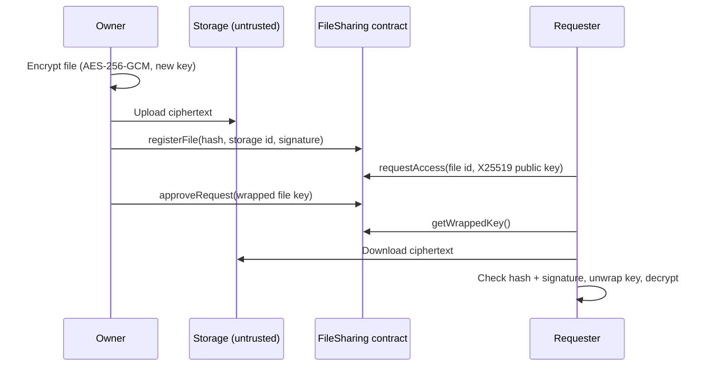

# SecureShare: end-to-end encrypted file sharing with blockchain access control


SecureShare lets a file owner share a file with selected people **without trusting
the storage server**. Files are encrypted on the owner's computer before upload,
an Ethereum smart contract records who asked for access and who was approved, and
only an approved requester can recover the key and decrypt the file.


## Features

- **End-to-end encryption:** AES-256-GCM with a fresh random key per file. The server only stores ciphertext.
- **Per-recipient key sharing:** the file key is wrapped for each approved requester with X25519 + HKDF + AES-GCM.
- **Integrity and authenticity:** the SHA-256 hash of the ciphertext and the owner's ECDSA signature are stored on chain. Tampered files are rejected before decryption.
- **On-chain access control:** request → approve / reject → revoke, enforced by a Solidity contract. Only the owner can approve.
- **Encrypted keystores:** user keys are protected with scrypt and are never stored in plaintext.
- **Audit log:** every action is a blockchain event, shown in the GUI.
- **Attack demos:** tampered storage, non-owner approval and wrong passphrase are all refused.

## How it works



## Tech stack

Python · cryptography · web3.py · Solidity 0.8.20 · Anvil (Foundry) · Streamlit · pytest / eth-tester

## Project structure

```
app/
  crypto/       file encryption, keystore, key wrapping, signatures
  storage/      simulated untrusted storage (ciphertext only)
  blockchain/   web3 client for the FileSharing contract
  gui/          Streamlit interface
  workflow.py   end-to-end steps used by the GUI
contracts/      FileSharing.sol
scripts/        deploy, readiness check and demo scripts
tests/          unit, contract and security tests
```

## Run it locally (Windows)

Requirements: Python 3.12, Git, and [Foundry](https://book.getfoundry.sh/getting-started/installation) for `anvil`.

**Terminal 1: start the local blockchain**

```powershell
anvil
```

**Terminal 2: install and run**

```powershell
git clone <this-repo-url>
cd <repo-folder>
python -m venv .venv
.venv\Scripts\activate
pip install -r requirements.txt
pip install -e .
copy .env.example .env      # then paste Anvil's account (0) private key into .env
python scripts/deploy_contract.py
python scripts/check_ready.py
streamlit run app/gui/streamlit_app.py
```

Restarted Anvil? Run `python scripts/deploy_contract.py` again.

## Tests

```powershell
pytest
```

The tests run on an in-memory blockchain (eth-tester), so Anvil and ETH are not needed.
They cover encryption, key wrapping, the contract rules, and attack cases.

## Security notes and limitations

- Revoking access stops future downloads, but cannot take back a key the requester already received.
- Storage is a local folder that simulates an untrusted cloud provider.
- This is a university prototype and has not been audited for production use.
